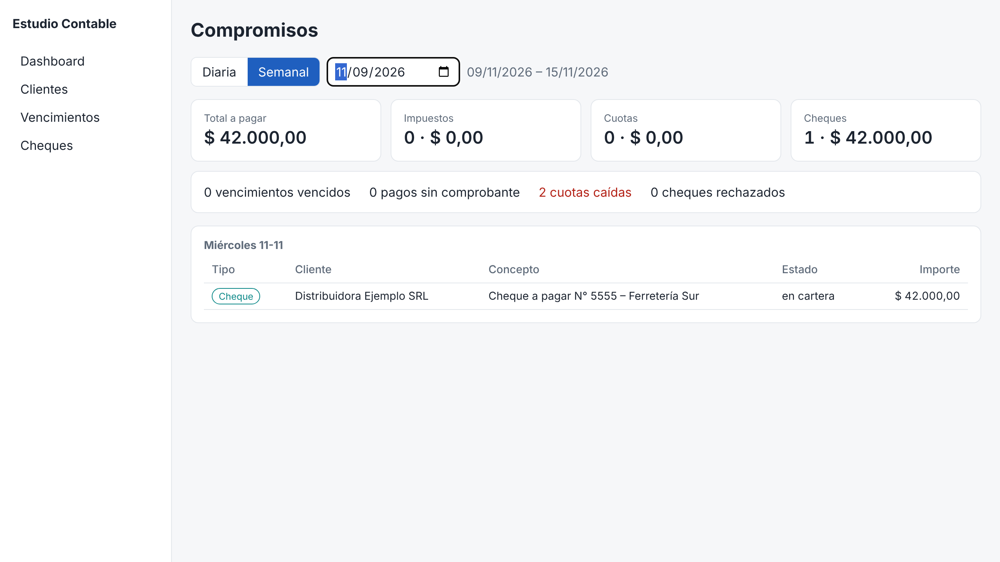
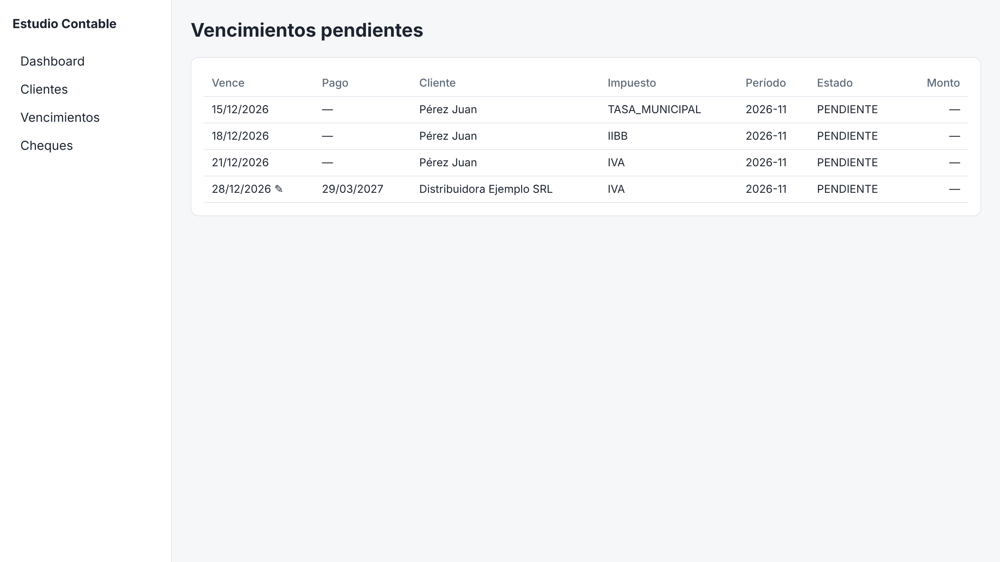

# Estudio Contable – Gestión financiera e impositiva

Sistema para centralizar la **agenda de vencimientos impositivos**, **planes de pago y créditos bancarios**, y el **seguimiento de cheques (físicos y ECHEQ)** de los clientes de un estudio contable, con dashboard diario/semanal y recordatorios automáticos por WhatsApp.

**Stack:** TypeScript · Express 5 · Prisma 6 · PostgreSQL 16 · Next.js 15 · Vitest · node-cron · WhatsApp Cloud API

## Capturas

| Dashboard semanal | Vencimientos |
|---|---|
|  |  |

Más en [`docs/capturas`](docs/capturas).

## Inicio rápido

```bash
cd estudio-contable
cp .env.example .env
npm install
npm run db:up          # PostgreSQL en Docker
npm run db:migrate     # aplica migraciones
npm run db:seed        # feriados 2026, categorías y 2 clientes demo
npm run build -w @estudio/shared

npm run dev:api        # http://localhost:4000/api/v1
npm run dev:worker     # tareas programadas (recordatorios, cuotas, resumen semanal)
npm run dev:web        # http://localhost:3000 (proxy /api/v1 → API)
```

Generar la agenda de un período: `curl -XPOST localhost:4000/api/v1/vencimientos/generar -H 'Content-Type: application/json' -d '{"periodo":"2026-11"}'`

## Tests

```bash
npm test               # reglas de dominio (packages/shared)
npm run typecheck
```

## Documentación

- [Arquitectura y estructura](docs/ARQUITECTURA.md)
- [Reglas de negocio](docs/REGLAS_NEGOCIO.md)
- [Endpoints de la API](docs/API.md)
- Modelo de datos: [`apps/api/prisma/schema.prisma`](apps/api/prisma/schema.prisma) · SQL: [`apps/api/prisma/migrations`](apps/api/prisma/migrations)
